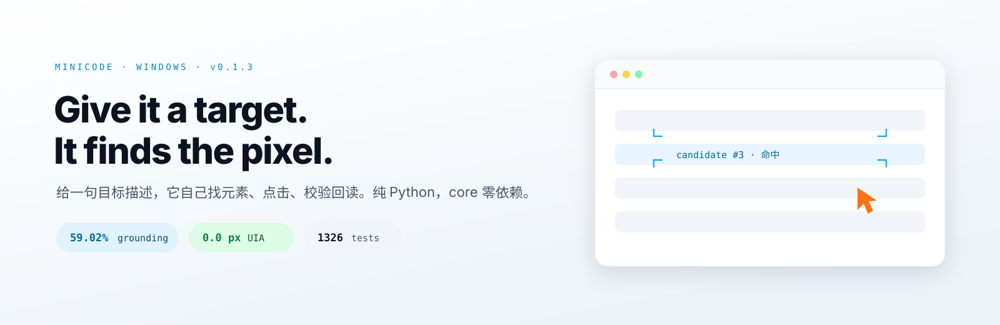
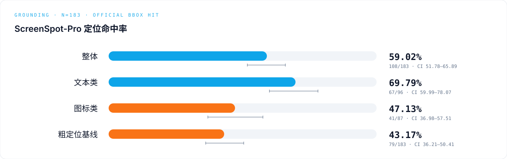
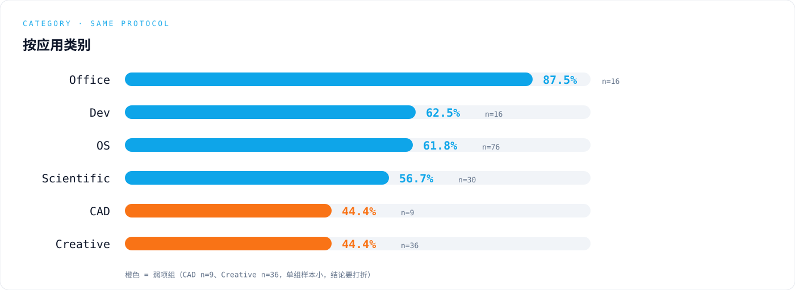
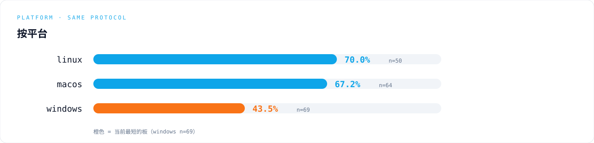
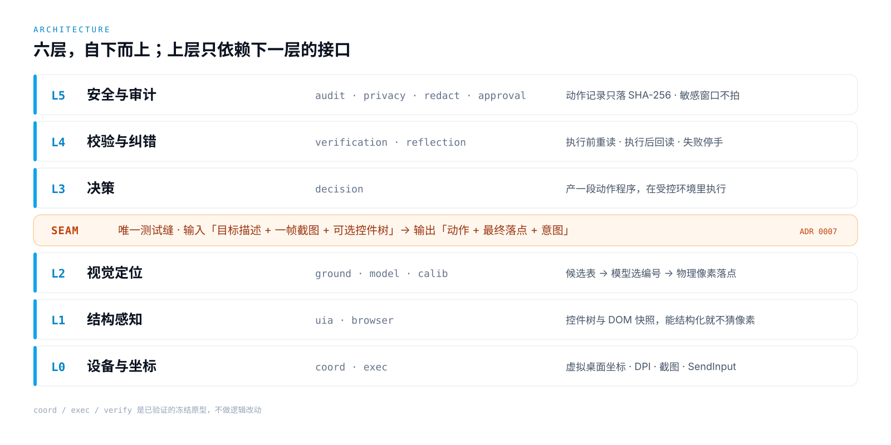

<div align="center">

# minicode

**Windows 桌面 computer-use agent —— 给一句目标描述，它自己找元素、点击、校验回读。**

[](https://www.python.org/)
[](LICENSE)
[](CHANGELOG.md)
[](https://www.microsoft.com/windows/)
[](#测试)

<picture>
  <source media="(prefers-color-scheme: dark)" srcset="docs/assets/hero-dark.svg">
  
</picture>

</div>

<table>
<tr>
<td width="33%" valign="top"><b>结构优先</b><br><sub>UIA 控件树 / 浏览器 DOM 能描述清楚的目标不猜像素；唯一命中时落点误差 <b>0.0 px</b>、模型调用 <b>0 次</b></sub></td>
<td width="33%" valign="top"><b>视觉兜底</b><br><sub>结构描述不了的目标走「截图 → 候选表 → 模型选编号 → 落点」；模型<b>只答编号，不产出坐标</b></sub></td>
<td width="33%" valign="top"><b>可复现评测</b><br><sub>评测台、统计脚本、画图脚本都在仓库里，同一份数据重跑可换出同一张图</sub></td>
</tr>
</table>

### 一眼看完的数字

| | | | |
|:--:|:--:|:--:|:--:|
| **59.02%**<br><sub>整体命中率<br>108/183</sub> | **43.17%**<br><sub>粗定位基线<br>79/183</sub> | **0.0 px**<br><sub>UIA 唯一命中<br>落点误差</sub> | **1326**<br><sub>单元测试<br>257 subtests</sub> |

ScreenSpot-Pro 官方 bbox 命中口径，n=183 分层抽样；全部数字的 Wilson 95% CI 见[实测](#实测分维度命中率)。

### 三步跑起来

| 1 · 装 | 2 · 配 | 3 · 跑 |
|:--|:--|:--|
| `pip install -e ".[vision,exec]"` | 复制 `.env.example` → `.env`，填 provider / base_url / api_key / model | `minicode action --target "开始"` |

不碰真桌面先试：`minicode action --fake --out runs`。

---

## 实测：分维度命中率

三张图由 `scripts/make_figures_svg.py` 生成（纯手写 SVG，无绘图库依赖），数字写死在脚本里并逐条对照 `runs/v2-eval-2016-control/sspro-report.json`，重跑可得同一张图。







| 类别 | 命中率 | n | | 平台 | 命中率 | n |
|:--|--:|--:|:--:|:--|--:|--:|
| Office | 87.5% | 16 | | linux | 70.0% | 50 |
| Dev | 62.5% | 16 | | macos | 67.2% | 64 |
| OS | 61.8% | 76 | | **windows** | **43.5%** | 69 |
| Scientific | 56.7% | 30 | | | | |
| CAD | 44.4% | 9 | | | | |
| Creative | 44.4% | 36 | | | | |

真机端到端（主口径）：wave1 3/5（60%）、wave2 3/9（33.3%）。

> **跨跑批噪声**：同配置两次独立跑批差 ±5.46 pp（±10 条，mid-p p=0.0989，CI 跨 0）。所以对外只报配对比较，不报「单次跑批绝对分的历史提升」。

## 诚实短板

- **windows 平台 43.5% 明显低于 linux 70.0% 和 macos 67.2%**（n=69 / 50 / 64）；
- **图标类 47.1% 明显低于文本类 69.8%**：图标没有可见文本，OCR 词框原理上召回不了，只能靠视觉通道，是当前最大短板；
- **CAD 44.4%、Creative 44.4% 是弱项组**（n=9 / 36，单组样本小，结论要打折）；
- **需要登录态的网站要人工先登录一次**（如微信扫码），agent 不做登录；
- **L3 的规划质量没有自动化覆盖**（只有 harness 单测）；
- **API 在 v0.1.x 仍可能变**。

这些不是免责声明，是下一版要动手的地方。

## 架构



六层自下而上，上层只依赖下一层的接口；`coord` / `exec` / `verify` 是已验证的冻结原型，不做逻辑改动。

### 三条关键设计

1. **唯一测试缝就是动作执行缝**：输入「目标描述 + 一帧截图 + 可选控件树」，输出「动作 + 最终落点 + 意图」。真机与假桌面共用同一套接线（[ADR 0007](docs/adr/0007-single-test-seam-action-execution.md)）。
2. **坐标契约**：工程端全程物理像素，唯一真值 = 物理像素 × 虚拟桌面原点；模型端量纲不写死，由运行时标定在候选标度里判定（[ADR 0006](docs/adr/0006-crop-local-coordinate-contract.md)）。
3. **模型选编号，不给坐标**：候选源先生成带编号候选表，模型只答编号，落点取候选框物理中心，零换算。

完整取舍见 [ARCHITECTURE.md](ARCHITECTURE.md) 与 [docs/adr/](docs/adr/)（8 条架构决策记录）。

## 与同类项目的定位差异

只写客观定位，不写别人的分数：

| 项目 | 它主打什么 | minicode 的差异 |
|:--|:--|:--|
| UFO²（微软） | UIA + 像素检测混合的 GUI agent，偏 Office 场景自动化 | 不绑定某一家端点；单一可替换执行缝，真机与假桌面共用同一套接线 |
| Windows-MCP | 轻量 MCP server，把 Windows 操作暴露给 LLM | 不止暴露操作：候选表、落点校验、评测台都在仓库里，可判定验收线 |
| UI-TARS（字节） | 端到端训练的 GUI grounding 模型 | 不训练自己的模型；结构优先，UIA 能唯一命中时不进模型 |

## 安装

```powershell
git clone https://github.com/xiaochuan7/minicode.git
cd minicode
pip install -e ".[vision,exec]"
```

**为什么 core 是零依赖**：坐标换算（标准库 `math`）、执行层（`ctypes` 直调 Win32 API）、模型 HTTP（标准库 `urllib`）都不需要第三方包，所以 `dependencies = []`。只有截图与图像处理拆进 extras：`exec`（mss + numpy）、`vision`（pillow + numpy）。

## 配置

支持两类端点——任意 **OpenAI 兼容端点**（`POST /chat/completions`，`Authorization: Bearer`）与 **Anthropic Messages**（`POST /v1/messages`，`x-api-key` + `anthropic-version`）。把 `.env.example` 复制成 `.env`，填四行：

```dotenv
MINICODE_PROVIDER=openai
MINICODE_BASE_URL=https://api.openai.com/v1
MINICODE_API_KEY=<your-key>
MINICODE_MODEL=gpt-4o
```

| 端点 | `MINICODE_PROVIDER` | `MINICODE_BASE_URL` | `MINICODE_MODEL` 例 |
|:--|:--|:--|:--|
| OpenAI | `openai` | `https://api.openai.com/v1` | `gpt-4o` |
| DeepSeek | `openai` | `https://api.deepseek.com/v1` | `deepseek-chat` |
| 阿里云百炼 DashScope | `openai` | `https://dashscope.aliyuncs.com/compatible-mode/v1` | `qwen3-vl-plus` |
| Anthropic | `anthropic` | `https://api.anthropic.com`（**不要**带 `/v1`） | `claude-sonnet-4-5` |

<details>
<summary>其它 OpenAI 兼容端点 / 本地模型怎么填</summary>

Moonshot / 智谱 / 硅基流动 / Ollama / vLLM / LM Studio / OpenRouter / OneAPI 都是 `provider=openai`，把 `base_url` 指到它的 `/v1`。不需要鉴权的本地端点（如 Ollama）把 `api_key` 填任意非空字符串。旧键 `MINICODE_ANTHROPIC_*` 仍然兼容，优先级低于新键；启动时会打一行实际生效的配置（`api_key` 脱敏，只留前 4 后 4）。

</details>

## 用法

```powershell
minicode --help                     # 列出全部子命令
minicode action --fake --out runs   # 假桌面跑一遍最小闭环（不碰真桌面，CI 可跑）
minicode action --target "开始"      # 真机最小闭环：截图 → 定位 → 点击 → 校验
```

<details>
<summary>真机最小闭环的真实终端输出（2026-10-26 采集，完整记录见 docs/EXAMPLES.md）</summary>

```text
========== M0 最小闭环 ==========
动作结果：ok=True 落点=(917, 1564)
意图    ：点击「开始」
回读偏差：0 px（验收要求 0）
落点复验：偏差=0.0 px（要求 ≤2 px）→ 通过
"channel": "uia",
"model_calls": 0,
```

</details>

动真机前请先拿桌面锁（人机互斥，锁文件不进 git）：

```powershell
python scripts/desktop_lock.py acquire --ticket demo
minicode action --target "开始"
python scripts/desktop_lock.py release
```

| 命令 | 作用 |
|:--|:--|
| `minicode capability` | UIA 通道能力探测（读控件树、回报候选） |
| `minicode calib` | 视觉通道标定：探针图 → 判定标度 → 准入判定 |
| `minicode ground` | 视觉定位：截图 → 候选表 → 模型选编号 → 落点 |
| `minicode action` | 最小闭环：截图 → 定位 → 点击 → 校验 |
| `minicode eval` | 评测跑批与统计（ScreenSpot-Pro 等） |
| `minicode e2e` | 端到端任务跑批（真机） |
| `minicode serve` | 本地 HTTP 服务 / 动作记录查询 |
| `minicode mcp` | MCP server：把动作能力暴露给外部 agent |

## 目录结构

| 路径 | 职责 |
|:--|:--|
| `src/minicode/coord/` `exec/` `verify/` | 冻结原型：坐标换算 / 截图与点击 / 落点校验（零依赖，不改逻辑） |
| `src/minicode/action/` | 动作协议 v1 + 动作执行缝 + 动作记录 |
| `src/minicode/uia/` `browser/` | L1 结构感知：控件树 / 浏览器 DOM |
| `src/minicode/ground/` `calib/` | L2 视觉定位：候选表 / 标定与准入 |
| `src/minicode/model/` | 横切：模型客户端（anthropic / openai 两种协议）+ 请求日志 |
| `src/minicode/decision/` | L3 决策：动作程序 |
| `src/minicode/verification/` `reflection/` | L4 校验与纠错 |
| `src/minicode/audit/` `privacy/` `redact/` `approval/` | L5 安全审计 |
| `src/minicode/eval/` `e2e/` `serve/` `mcp/` | 评测 / 端到端 / HTTP 服务 / MCP |
| `docs/adr/` · `docs/EXAMPLES.md` | 8 条架构决策记录 · 真实终端输出全记录 |

## 测试

```powershell
python -m pytest -q     # 1326 passed, 257 subtests passed
python -m ruff check .  # All checks passed!
```

`src/minicode/coord`、`exec`、`verify` 是三个已验证的冻结原型：coord 与 exec 各有 README 与自测脚本，`verify/` 下是**会真调 API / 真截图 / 真点鼠标**的脚本式实测（默认不被 pytest 收集）。

## 隐私与安全

- 密钥只从仓库根目录的 `.env` 读，代码里没有第二个凭据来源；请求日志只记耗材与状态，不记密钥。
- 动作记录只落 SHA-256，不落截图本体；敏感窗口（标题命中敏感词表 / 系统对话框）在**抓帧之前**就被拦下，画面不进模型上下文。
- 控件树送模型前必须过脱敏器（两个开关同时打开才放行，fail-closed）；危险动作要过审批闸门。
- 详见[隐私政策](docs/privacy-policy.md)。

## License

[MIT](LICENSE) © 2026 xiaochuan7

## English Summary

minicode is a **Windows desktop computer-use agent** written in pure Python (3.11+, zero-dependency
core): given a natural-language target, it finds the element, clicks it, and verifies the result by
reading the screen back.

- **Model-agnostic**: any OpenAI-compatible endpoint (`POST /chat/completions`) or Anthropic
  Messages (`POST /v1/messages`); switching models does not change the wiring.
- **Structure-first**: UIA control trees and browser DOM snapshots are preferred — when UIA yields
  a unique hit, the agent lands with **0.0 px** error and **0 model calls**. Vision is a fallback:
  screenshot → candidate table → the model picks a number (never coordinates) → landing point.
- **Reproducible evaluation**: the evaluation harness, the statistics, and the chart generator all
  live in the repo.

Measured on a ScreenSpot-Pro stratified sample (official bbox-hit protocol, n=183), grounding
accuracy is **59.02% (108/183, Wilson 95% CI [51.78%, 65.89%])**, versus **43.17% (79/183)** for the
coarse-only baseline. Known weaknesses, stated plainly: icon targets (**47.13%**, 41/87) trail text
targets (**69.79%**, 67/96); windows screens score **43.5%** (n=69) against linux 70.0% (n=50) and
macos 67.2% (n=64); CAD and Creative both sit at 44.4%; sites requiring login still need a human to
sign in once; L3 planning quality has no automated coverage yet; and the API may still change
within v0.1.x.
