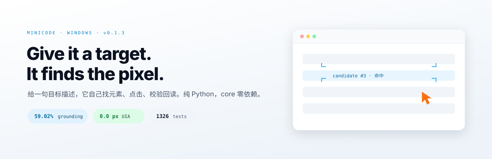
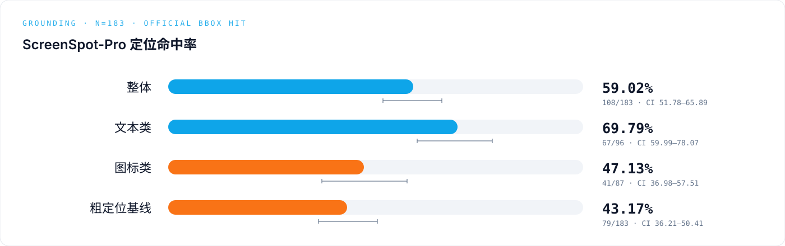
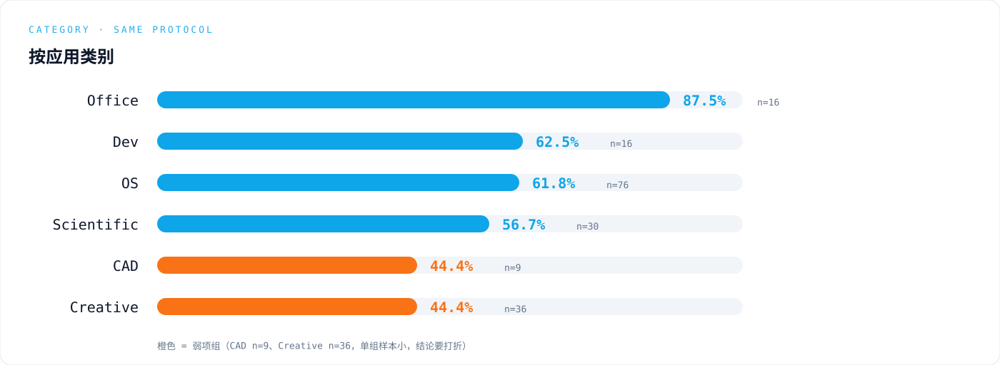
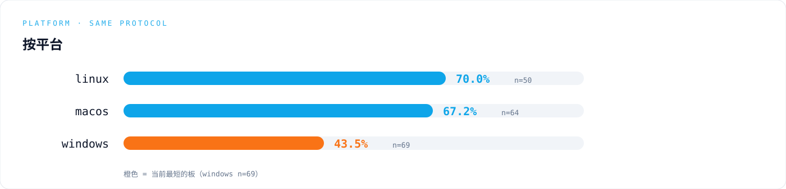
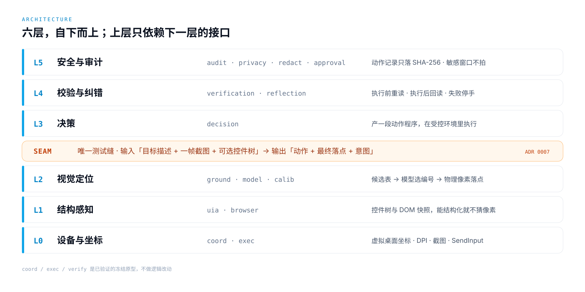

<div align="center">

# minicode

**Windows 桌面 computer-use agent —— 给一句目标描述，它自己找元素、点击、校验回读。**

[](https://www.python.org/)
[](LICENSE)
[](CHANGELOG.md)
[](https://www.microsoft.com/windows/)
[](https://github.com/xiaochuan7/minicode/actions/workflows/ci.yml)

<picture>
  <source media="(prefers-color-scheme: dark)" srcset="docs/assets/hero-dark.svg">
  
</picture>

</div>

<table>
<tr>
<td width="33%" valign="top"><b>结构优先</b><br><sub>UIA 控件树 / 浏览器 DOM 能描述清楚的目标不猜像素；唯一命中时落点误差 <b>0.0 px</b>、模型调用 <b>0 次</b></sub></td>
<td width="33%" valign="top"><b>视觉兜底</b><br><sub>结构描述不了的目标走「截图 → 候选表 → 模型选编号 → 落点」；模型<b>只答编号，不产出坐标</b></sub></td>
<td width="33%" valign="top"><b>可复现评测</b><br><sub>评测台、统计脚本、画图脚本都在仓库里，同一份数据重跑可换出同一张图</sub></td>
</tr>
</table>

### 一眼看完的数字

| | | | |
|:--:|:--:|:--:|:--:|
| **59.02%**<br><sub>整体命中率<br>108/183</sub> | **43.17%**<br><sub>粗定位基线<br>79/183</sub> | **0.0 px**<br><sub>UIA 唯一命中<br>落点误差</sub> | **CI 全绿**<br><sub>单元测试<br>每次提交动态验证</sub> |

ScreenSpot-Pro 官方 bbox 命中口径，n=183 分层抽样；全部数字的 Wilson 95% CI 见[实测](#实测分维度命中率)。

> **脚注 · 59.02% 走的是哪条路**：这个数字是**点式定位路径**的成绩（模型直接输出坐标，
> 配运行时标定），**不是**首屏宣传的「模型只答编号」路线在同口径下的分数——编号候选
> 分支只在 42 条小子样本上量过，未在这 183 条上复测。两者不可互相换算，请勿用 59.02%
> 估计编号路线的成绩（详见[评测配置](#评测配置)）。

### 三步跑起来

| 1 · 装 | 2 · 配 | 3 · 跑 |
|:--|:--|:--|
| `pip install -e ".[vision,exec]"` | 复制 `.env.example` → `.env`，填 provider / base_url / api_key / model | `minicode action --target "开始"` |

不碰真桌面先试：`minicode action --fake --out runs`。

---

## 实测：分维度命中率

三张图由 `scripts/make_figures_svg.py` 生成（纯手写 SVG，无绘图库依赖），数字写死在脚本里并逐条对照 `runs/v2-eval-2016-control/sspro-report.json`，重跑可得同一张图。







| 类别 | 命中率 | n | | 平台 | 命中率 | n |
|:--|--:|--:|:--:|:--|--:|--:|
| Office | 87.5% | 16 | | linux | 70.0% | 50 |
| Dev | 62.5% | 16 | | macos | 67.2% | 64 |
| OS | 61.8% | 76 | | **windows** | **43.5%** | 69 |
| Scientific | 56.7% | 30 | | | | |
| CAD | 44.4% | 9 | | | | |
| Creative | 44.4% | 36 | | | | |

真机端到端（主口径）：wave1 3/5（60%）、wave2 3/9（33.3%）。
⚠️ 这两个样本量**没有统计意义**（3/5 的 Wilson 95% CI 是 [19.4%, 92.2%]）——
它们只是「真机闭环走得通」的冒烟证据，不是能力度量。

> 对外只报配对比较，不报「单次跑批绝对分的历史提升」。此前引用的跨跑批噪声数字
> （±5.46 pp / mid-p p=0.0989）因仓库内无产物可复算已撤下，待配对明细入库后恢复
> （见 [CHANGELOG](CHANGELOG.md) 未发布节）。

### 评测配置

- **判定口径**：ScreenSpot-Pro 官方 bbox 命中判定（落点按 img_size 归一化后落在 GT 框内，
  双侧闭区间），与官方脚本一致；GT 只用于判定，无自我循环。
- **样本量与抽样**：计划分层抽样 330 条；本地缺图的样本被静默过滤后实际 n=183。
  这是**非随机子集**：分维度结论——尤其平台维度（windows 43.5% vs linux 70.0%）——
  受缺失机制影响，解读要打折。
- **调参集即评测集**：整屏档位、crop 几何等超参是在同一批 183 条上扫描选优后报的同批
  分数，绝对值带未量化的乐观偏差；同批配对的相对比较（59.02% vs 43.17%）受此影响较小。
  修复路径：跑独立确认集后替换头条数字。
- **模型与端点未记录**：该批分数所用的模型与端点没有记录在仓库里，这是本仓库已知的
  复现缺口。在补上记录之前，请不要把 59.02% 当作任何特定模型的成绩来引用。

## 诚实短板

- **windows 平台 43.5% 明显低于 linux 70.0% 和 macos 67.2%**（n=69 / 50 / 64）；
- **图标类 47.1% 明显低于文本类 69.8%**：图标没有可见文本，OCR 词框原理上召回不了，只能靠视觉通道，是当前最大短板；
  本版的候选源补齐（V3）**验证了根因但没有翻动这个数字**：同批量化显示 OCR 词框对 icon 目标覆盖 **0/30**、零模型启发式 **1/30**、ScreenParser 检测模型 **2/30**（ScreenSpot-Pro 的 4K 密集专业 UI 对域外检测器太难）——「缺候选」坐实，「补候选就能救」在这个基准上未被证实（[runs/v3 口径](docs/v6-abc-comparison.md)）；
- **CAD 44.4%、Creative 44.4% 是弱项组**（n=9 / 36，单组样本小，结论要打折）；
- **需要登录态的网站要人工先登录一次**（如微信扫码），agent 不做登录；
- **L3 的规划质量没有自动化覆盖**（只有 harness 单测）；
- **API 在 v0.1.x 仍可能变**。

这些不是免责声明，是下一版要动手的地方。

## 任务级评测：30 条真机任务

30 条本机可复现任务（文件 8 · 计算 4 · 浏览器 3 · 界面 7 · 复合 4 · 反例 4），每条
reset / steps / judge 三件套，判分**只读状态**（UIA 控件值 / 文件内容 / 磁盘 / 窗口标题，
不读截图）。attempt 状态五类：`pass / fail / error / blocked / paused`——**paused（护栏 6
对真实用户键鼠的让位）与 blocked（环境前置失败）从分母剔除**。

| 轮次 | pass | fail | error | paused | blocked | 危险动作 | 人工接管 |
|:--|:--:|:--:|:--:|:--:|:--:|:--:|:--:|
| round1 | 89 | 0 | 0 | 1 | 0 | 0 | 0 |
| round2 | 69 | 1 | 0 | 19 | 1 | 0 | 0 |
| round3-redo | 90 | 0 | 0 | 0 | 0 | 0 | 0 |
| **合计（90 轮×任务对）** | **248/249 = 99.6% s@1** | | | | | **0** | **0** |

<sub>上表两处修正，先在此说明：① `round3` 原轮因桌面被真实用户占用（真实键鼠 → 级联 paused）作废，重跑为 `round3-redo`；② `i16` 单任务在判分缺陷修复后复验 3/3 通过并换入，**原始产出为 245/249 s@1、85/87 s@3**。`round1` / `round2` 跑于判分三洞修复前，其 `i16` 的 pass 来自旧判分的恒真缺陷（非真实执行）——保留原样不篡改，以 `round3-redo` 为准。</sub>

- **success@3 = 86/87 = 98.9%**（任务级 ≥1 次 pass，按轮×任务对池化；唯一 fail 是 round2
  复合类 x23 的第 3 次 attempt）；
- **危险动作 0、人工接管 0**（L1 口径：不可逆在策略层直接拒绝，到不了审批人）；
- 判分器**负向对照 3/3**：judge 断言必然不成立 → fail；脏状态（reset 写错/不跑）→ fail；
  伪造错误状态（计算器 999）→ 拒绝。判分能失败，30/30 才有含金量。

完整口径、类别与通道拆分、每任务 attempt 原样状态、作废与替换注记见
[docs/w4-eval-summary.md](docs/w4-eval-summary.md)（由 `scripts/make_eval_table.py`
从 attempt 明细重算，可复现）。

### 长任务评测集（W4/W5）：跨应用 + 故障注入 + 自愈层

第二批任务把链路拉长（10~30 步、跨窗口/跨应用、中途保状态），并在步骤序列
中间注入确定性故障（对话框/遮挡失焦/位置漂移/元素禁用四类）。每步包一层
**自愈包装**（W5）：失败按五类分类（找不到元素/点不动/界面没变/被对话框
打断/位置漂移）→ 对应策略（重生成描述、换通道、等待+变化检测、复核后关
对话框、重扫候选）→ 触发/救回落盘。**判分只读状态**，并区分
**clean（一次做对）** vs **healed（自愈救回）** vs **失败**。

首轮实测（T1–T4，覆盖全部四类故障）：**4/4 pass（全部 clean，零自愈触发）**
——确定性步骤序列对这四类故障的天然耐受度比预期高；自愈层的价值在「步骤
本身失败」的场景，本轮未出现。诚实注记：T4 按预登记口径 pass 但文件尾部有
陈旧缓冲残留（两种读法并排报告）；F1 对话框被 ALT 置前绕开而非关闭。
T5–T10 设计完成、本轮未跑。设计与实测明细：
[docs/w4-long-tasks.md](docs/w4-long-tasks.md) / [docs/w4-long-results.md](docs/w4-long-results.md)。

## 视觉通道：可插拔、换模型配对、视觉必需任务与 A/B/C

### 视觉通道可插拔（V1）

决策层 LLM 与视觉通道 VLM 各有一组配置键：`MINICODE_VISION_{PROVIDER,BASE_URL,API_KEY,MODEL}`
**逐字段**覆盖决策层的 `MINICODE_*`，没配的字段逐字段回落 —— 只配一组键时行为与从前
完全一致。每次视觉调用落一行结构化日志：model_id、端点主机、实际图尺寸、耗时、
**429 单独标记**（与模型失败分开计数）、原始回复长度。

**默认口径（2026-11-03 收口）**：视觉通道与决策层**同一份配置**（deepseek-v4.1-flash），
不再默认引用第二模型 —— **换模型这条路已证伪一次**（见下节 V2）。可插拔键组保留
（机制与测试都在），但没有新证据前不要动默认。

### 换模型配对实验（V2，n=60）

同批 60 条（ScreenSpot-Pro，与 W6 完全同批同提示词同判定），唯一差异是模型：

| 臂 | 模型 | 命中 | Wilson 95% CI |
|:--|:--|:--:|:--:|
| A（对照，现状） | deepseek-v4.1-flash（opencode） | 13/60 | [13.1%, 33.6%] |
| B（实验） | Qwen3.8-27B（Radeon） | 9/60 | [8.1%, 26.1%] |

Δ = −6.67 pp，配对 bootstrap 95% CI [−20.0, +6.7] **跨 0**；mid-p McNemar
p = 0.332；MDE = 18.7 pp，|Δ| 未达 MDE —— **这个样本量下判不出两臂差异，
"哪一臂赢"不算数**。两臂提示词逐字相同（生产粗定位提示词，无特调）；
完整统计与限流拆账见 [docs/v2-vision-paired.md](docs/v2-vision-paired.md)
（配对 JSON 入库可复算）。

**处置结论：换模型已证伪一次** —— 实验臂命中更低（9/60 vs 13/60）且 Δ 未达 MDE，
不值得再投入。视觉通道默认且唯一使用决策层同款 deepseek-v4.1-flash；V2 的双模型
跑批脚本已删除（报告生成器与配对 JSON 保留，可复算），Qwen 仅作为 V1 可插拔
机制的测试夹具存在。

### 视觉必需任务集（V5）与 A/B/C 三组（V6）

W4 的 30 条任务全走 UIA、模型调用 0 次 —— 不证明视觉能用。新增 8 条
**结构通道原理上做不到**的任务（目标画在 `<canvas>` 里，DOM 无节点，
UIA 必然 `TARGET_NOT_FOUND` → 视觉通道兜底），judge 只读窗口标题：

| 组 | 配置 | success@1 | 说明 |
|:--|:--|:--:|:--|
| A（现状） | 无候选源、无重排 | **6/8** | 粗定位→crop 精定位，2 次模型调用/步 |
| B | + ScreenParser 检测候选（Apache-2.0） | **6/8** | 编号选择，1 次模型调用/步，修复了 A 的顽固粗定位偏移（w01） |
| C | B + d3 重排 | **0/8** | d3 全部 fail-closed 拒绝（见下） |

C 组的 8 次 d3 调用拆账：成功返回 2 次（confidence 0.22/0.25 < 0.5 → **不点**）、
超时 3 次（16~20 选项 120s 跑不完）、网关 400「Decision model not found」3 次 ——
**闸门全部兑现为"不点"**：对照组 B 同批任务无一点错。结论如实写：
d3 重排的可用性取决于**候选描述的信息量**（检测器同质标签让 d3 无法区分）
与网关稳定性，两个都是环境侧问题。完整三组表与逐任务对照见
[docs/v6-abc-comparison.md](docs/v6-abc-comparison.md)。

### 精定位专项量化（W2）：第二级有没有独立价值

两级链路的第二级（crop 精定位）此前从未被单独量化。注入式三臂（粗定位一级
被替换、精定位一级全生产代码）+ 自建 canvas 偏移扫描，**结论：有独立、统计
显著的价值**：

| 对比（同批配对） | Δ | mid-p McNemar p | 95% CI |
|:--|:--:|:--:|:--|
| 粗定位单独 13/46 vs 粗+精 22/46 | **+19.6pp** | **0.0063** | [+6.5, +32.6] 排 0 |
| 基线 vs GT 粗点+精 39/60 | **+43.3pp** | **1.4e-6** | 达 MDE |
| 基线 vs GT 粗点+精+zoom 44/60 | **+51.7pp** | **4.1e-9** | 达 MDE |

中位落点误差 41px → 5.7px（GT 粗点+zoom）；canvas 真值扫描：50/100px 粗点
漂移基本无感（按钮 8/8 全保），**200px 是小图标的能力边界**（3/8）。生产的
crop 尺寸/取整/zoom 规则经 A/B 全部维持原状（每一项都有数字）；真正的瓶颈
是模型输出稳定性（思考链吃穿预算 → 23~30% 回落），不是几何参数。完整报告
（含全部配对数字与诚实口径）：[docs/w2-refine-quant.md](docs/w2-refine-quant.md)。

### d3 候选重排：逐候选 yes/no（W3 改制）

d3 是决策模型（不生成文本，只要概率），端点 `/v1/systemone`（走
`/chat/completions` 实测 400）。**W3 把 V4 的「16~20 选项一次问」改成逐候选
判定**（整包评分实测 3 超时 + 3 网关 400 + 2 低置信，已证伪）：

1. **启发式排序前 K 个候选**（默认 3，可配）逐个问一道 `noul` 题
   （"这个候选是否是要点的目标？"），拿 yes 概率；
2. 取 yes 概率最高者；**最高者 < 0.6（可配）→ 不点，转人工**（fail-closed）；
3. **d3 不可用（超时/400/网关错）→ 跳过重排，用启发式 top1 继续**
   （记 `rerank_unavailable`）——不再因 d3 挂了让整条任务失败；
   429 按 60s 固定退避并**单独计数**（不计入模型失败）；
4. **0.0px 契约**：d3 只决定"选哪个候选"，落点永远取候选框物理中心 ——
   模型/重排器永远不输出坐标；
5. 每次调用落一行 JSONL（yes 概率、confidence、耗时、HTTP 状态、429 标记、
   候选序号）——逐候选可审计。

8 条 canvas 任务的「有 d3 vs 无 d3」对照实测：**A 组 8/8（视觉通道 8/8 使用），
C 组 0/8** —— 逐候选判定 20 次调用 18 次 HTTP 200（零超时零 400，延迟中位
619ms，**调用可用性较 V4 整包模式解决**），但 yes 概率全部 0.008~0.381
（中位 0.081）< 0.6 → **全部 fail-closed 拒绝**：瓶颈从「调用不可用」转移到
「判定质量」（候选描述同质化，d3 对画布提议候选明确说「不」）；闸门兑现为
不点 = 零错误点击。报告：[docs/w3-d3-rerank.md](docs/w3-d3-rerank.md)。

## 架构



六层自下而上，上层只依赖下一层的接口；`coord` / `exec` / `verify` 是已验证的冻结原型，不做逻辑改动。

### 三条关键设计

1. **唯一测试缝就是动作执行缝**：输入「目标描述 + 一帧截图 + 可选控件树」，输出「动作 + 最终落点 + 意图」。真机与假桌面共用同一套接线（[ADR 0007](docs/adr/0007-single-test-seam-action-execution.md)）。
2. **坐标契约**：工程端全程物理像素，唯一真值 = 物理像素 × 虚拟桌面原点；模型端量纲不写死，由运行时标定在候选标度里判定（[ADR 0006](docs/adr/0006-crop-local-coordinate-contract.md)）。
3. **模型选编号，不给坐标**：候选源先生成带编号候选表，模型只答编号，落点取候选框物理中心，零换算。
   ⚠️ **这不是自创路线**：「编号选择的 GUI grounding」属 Set-of-Mark（[arXiv 2310.11441](https://arxiv.org/abs/2310.11441)）
   与 WebAgent 的 axtree grounding（[arXiv 2309.08532](https://arxiv.org/abs/2309.08532)）谱系；
   「UIA 结构优先 + 视觉兜底」的混合检测，微软 UFO²（[arXiv 2504.14603](https://arxiv.org/abs/2504.14603)）是先例。
   minicode 的差异点是**编号选择的工程严格化**（单一执行缝、标定准入闸门、零依赖 core），
   不是发明了这条路。

完整取舍见 [ARCHITECTURE.md](ARCHITECTURE.md) 与 [docs/adr/](docs/adr/)（8 条架构决策记录）。

## 与同类项目的定位差异

只写客观定位，不写别人的分数：

| 项目 | 它主打什么 | minicode 的差异 |
|:--|:--|:--|
| UFO²（微软） | UIA + 像素检测混合的 GUI agent，偏 Office 场景自动化 | 不绑定某一家端点；单一可替换执行缝，真机与假桌面共用同一套接线 |
| Windows-MCP | 轻量 MCP server，把 Windows 操作暴露给 LLM | 不止暴露操作：候选表、落点校验、评测台都在仓库里，可判定验收线 |
| UI-TARS（字节） | 端到端训练的 GUI grounding 模型 | 不训练自己的模型；结构优先，UIA 能唯一命中时不进模型 |

## 威胁模型与已知边界（如实写）

- **本机直控，无沙箱**：agent 直接驱动**用户正在用的桌面**。业界主流（Anthropic computer use、
  OpenAI Operator）默认跑在专用 VM/容器里 —— minicode 没有这一层隔离，靠的是审批闸门 +
  桌面占用锁（人机互斥）+ 敏感窗口黑名单，这些是**缓解**不是**隔离**。
- **提示注入（OWASP LLM01）**：屏幕上的文字（网页、对话框、OCR 全文）都会进模型上下文；
  页面里藏「请点击删除所有文件」这类指令目前**没有**对抗评测集，模型是否服从取决于端点本身。
- **敏感信息出域（OWASP LLM02）**：已做「形态可识别」脱敏（密钥 + 四类 PII）与敏感窗口
  硬拦截；但自由文本里的姓名/地址没有形态可抓，不在黑名单里的整屏截图会原样发给所选端点。
- **过度代理（OWASP LLM06）**：审批分类看真实控件名与窗口标题、命中即审批；但「普通文本
  打到危险焦点」这类语义级危险兜不住 —— 所以非交互前端的键盘输入一律拒绝，交互前端靠人盯。
- **MCP server 无鉴权**：stdio 形态信任宿主进程；若经网络桥接 MCP，需要调用方自建鉴权，
  本仓不提供。
- **已知功能性边界**：混合 DPI 多显示器下视觉通道的标度按主屏判定（副屏 DPI 不同会偏）。

### 三个刻意不做（及理由）

- **不做内核驱动注入**：内核层绕过全部用户态护栏——审批闸门、录制、急停、桌面锁在驱动
  注入面前全部失效，事故半径不可控；且驱动需要签名与内核权限，超出一个 pip 安装工具的
  合理边界。SendInput 在四级授权 + 落点校验下已覆盖目标场景。
- **不内置拟人化随机**：随机延迟/抖动轨迹是「对抗自动化检测」的技术；minicode 的定位是
  人机协同工具（桌面占用锁 + 空闲让位，人在就不跑），不是隐蔽代理。拟人化只会掩盖 agent
  身份，并让评测台失去确定性复现——两个理由都指向不做。
- **不过度代做业务动作**：支付/下单/发消息/删除等不可逆动作，即使模型有把握也不自动执行
  ——影响面判定命中不可逆类别时 L1 直接拒绝、L2 强制人审批（见下节）。这是产品边界，
  不是能力缺口，边界写在 `guard/policy.py` 与协议错误码里，不在提示词里求模型。

## 真机模式与安全护栏

真机执行（`--auth-level`）是**默认关着的能力**，开了也只有一组叠加的闸：

| 级别 | 语义 | 典型用途 |
|:--|:--|:--|
| `L0` | 只读观测（可选 dry-run：管线照跑、零注入） | 让 agent「看」不让它「动」 |
| `L1` | 窗口白名单 + 不可逆直接拒绝 | 无人值守的常规任务（评测台默认） |
| `L2` | 在 L1 之上，敏感动作强制人工审批 | 半监督场景 |
| `L3` | 放开交互前端输入，预算与录屏在场 | 全自动，单次限时 |

在四级之上的常驻护栏：**急停**（全局快捷键 Ctrl+Alt+Shift+K，watchdog 线程轮询，
真机实测 32ms 触发，`runs/w3/estop-selftest.json`）、**预算**（步数/时长/模型调用，
超限熔断）、**空闲让位**（检测到真实用户键鼠输入，agent 立即让位——评测台第二轮的
19 次 paused 就是它在工作，不是故障）、**桌面占用锁**（人机互斥，锁文件带占用者与意图）、
**敏感窗口黑名单**（密码框/支付类标题命中即拒）、**每步 trace 录制**（落点、结果、
脱敏控件树摘要、截图哈希）。

真实 trace 的回放样例见 [docs/trace-replay-demo.html](docs/trace-replay-demo.html)
（由 `scripts/render_trace_demo.py` 从 W3 真机 trace 生成——包括护栏把一次越权点击
拦下来的记录）。评测台的 30 条任务、判分与指标口径见 [docs/w4-eval-summary.md](docs/w4-eval-summary.md)。

## 安装

```powershell
git clone https://github.com/xiaochuan7/minicode.git
cd minicode
pip install -e ".[vision,exec]"
```

**为什么 core 是零依赖**：坐标换算（标准库 `math`）、执行层（`ctypes` 直调 Win32 API）、模型 HTTP（标准库 `urllib`）都不需要第三方包，所以 `dependencies = []`。只有截图与图像处理拆进 extras：`exec`（mss + numpy）、`vision`（pillow + numpy）。

## 配置

支持两类端点——任意 **OpenAI 兼容端点**（`POST /chat/completions`，`Authorization: Bearer`）与 **Anthropic Messages**（`POST /v1/messages`，`x-api-key` + `anthropic-version`）。把 `.env.example` 复制成 `.env`，填四行：

```dotenv
MINICODE_PROVIDER=openai
MINICODE_BASE_URL=https://api.openai.com/v1
MINICODE_API_KEY=<your-key>
MINICODE_MODEL=gpt-4o
```

| 端点 | `MINICODE_PROVIDER` | `MINICODE_BASE_URL` | `MINICODE_MODEL` 例 |
|:--|:--|:--|:--|
| OpenAI | `openai` | `https://api.openai.com/v1` | `gpt-4o` |
| DeepSeek | `openai` | `https://api.deepseek.com/v1` | `deepseek-chat` |
| 阿里云百炼 DashScope | `openai` | `https://dashscope.aliyuncs.com/compatible-mode/v1` | `qwen3-vl-plus` |
| Anthropic | `anthropic` | `https://api.anthropic.com`（**不要**带 `/v1`） | `claude-sonnet-4-5` |

<details>
<summary>其它 OpenAI 兼容端点 / 本地模型怎么填</summary>

Moonshot / 智谱 / 硅基流动 / Ollama / vLLM / LM Studio / OpenRouter / OneAPI 都是 `provider=openai`，把 `base_url` 指到它的 `/v1`。不需要鉴权的本地端点（如 Ollama）把 `api_key` 填任意非空字符串。旧键 `MINICODE_ANTHROPIC_*` 仍然兼容，优先级低于新键；启动时会打一行实际生效的配置（`api_key` 脱敏，只留前 4 后 4）。

</details>

## 用法

```powershell
minicode --help                     # 列出全部子命令
minicode action --fake --out runs   # 假桌面跑一遍最小闭环（不碰真桌面，CI 可跑）
minicode action --target "开始"      # 真机最小闭环：截图 → 定位 → 点击 → 校验
```

<details>
<summary>真机最小闭环的真实终端输出（2026-10-26 采集，完整记录见 docs/EXAMPLES.md）</summary>

```text
========== M0 最小闭环 ==========
动作结果：ok=True 落点=(917, 1564)
意图    ：点击「开始」
回读偏差：0 px（验收要求 0）
落点复验：偏差=0.0 px（要求 ≤2 px）→ 通过
"channel": "uia",
"model_calls": 0,
```

</details>

动真机前请先拿桌面锁（人机互斥，锁文件不进 git）：

```powershell
python scripts/desktop_lock.py acquire --ticket demo
minicode action --target "开始"
python scripts/desktop_lock.py release
```

| 命令 | 作用 |
|:--|:--|
| `minicode capability` | UIA 通道能力探测（读控件树、回报候选） |
| `minicode calib` | 视觉通道标定：探针图 → 判定标度 → 准入判定 |
| `minicode ground` | 视觉定位：截图 → 候选表 → 模型选编号 → 落点 |
| `minicode action` | 最小闭环：截图 → 定位 → 点击 → 校验 |
| `minicode eval` | 评测跑批与统计（ScreenSpot-Pro 等） |
| `minicode e2e` | 端到端任务跑批（真机） |
| `minicode serve` | 本地 HTTP 服务 / 动作记录查询 |
| `minicode mcp` | MCP server：把动作能力暴露给外部 agent |

## 目录结构

| 路径 | 职责 |
|:--|:--|
| `src/minicode/coord/` `exec/` `verify/` | 冻结原型：坐标换算 / 截图与点击 / 落点校验（零依赖，不改逻辑） |
| `src/minicode/action/` | 动作协议 v1 + 动作执行缝 + 动作记录 |
| `src/minicode/uia/` `browser/` | L1 结构感知：控件树 / 浏览器 DOM |
| `src/minicode/ground/` `calib/` | L2 视觉定位：候选表 / 标定与准入 |
| `src/minicode/model/` | 横切：模型客户端（anthropic / openai 两种协议）+ 请求日志 |
| `src/minicode/decision/` | L3 决策：动作程序 |
| `src/minicode/verification/` `reflection/` | L4 校验与纠错 |
| `src/minicode/audit/` `privacy/` `redact/` `approval/` | L5 安全审计 |
| `src/minicode/eval/` `e2e/` `serve/` `mcp/` | 评测 / 端到端 / HTTP 服务 / MCP |
| `docs/adr/` · `docs/EXAMPLES.md` | 8 条架构决策记录 · 真实终端输出全记录 |

## 测试

```powershell
python -m pytest -q     # 全量单元测试（假桌面，不碰真机）
python -m ruff check .  # 静态检查
```

CI（[.github/workflows/ci.yml](.github/workflows/ci.yml)）：windows-latest + Python 3.11，
每次 push / PR 跑全量 pytest 与 ruff —— 测试规模由 CI 动态验证，
README 不再写死一个人工数出来的数字（人工计数任何提交即失真）。

`src/minicode/coord`、`exec`、`verify` 是三个已验证的冻结原型：coord 与 exec 各有 README 与自测脚本，`verify/` 下是**会真调 API / 真截图 / 真点鼠标**的脚本式实测（默认不被 pytest 收集）。

## 隐私与安全

- 密钥只从仓库根目录的 `.env` 读，代码里没有第二个凭据来源；请求日志只记耗材与状态，不记密钥。
- 动作记录与决策报告落盘前都过同一套脱敏（密钥形态 + 手机号 / 身份证 / 邮箱 / 银行卡四类 PII 形态）；
  ⚠️ 这只防「**形态可识别**」的明文 —— 不承诺覆盖姓名、地址等无形态 PII。
- 敏感窗口（标题命中敏感词表 / 系统对话框）在**抓帧之前**就被拦下，画面不进模型上下文；
  ⚠️ 不在黑名单里的整屏截图仍会以 base64 **原样发送到所选端点** —— 视觉通道本身不是脱敏通道，
  不要在敏感内容外露的桌面上开真机模式。
- OCR 全文（`observe()`）**默认脱敏后**才回灌模型与落盘；显式关闭：`MINICODE_OCR_REDACT=0`。
- 控件树送模型前必须过脱敏器（两个开关同时打开才放行，fail-closed）；危险动作要过审批闸门。
  ⚠️ 审批分类看的是**模型自报措辞 + 真实控件名/窗口标题**，但它兜的是「危险词」——
  非交互前端（HTTP / MCP 动作程序）的键盘输入（type_text / press_key）**一律拒绝**。
- 本地 HTTP serve 的写接口默认 403：设 `MINICODE_SERVE_TOKEN` 才解锁（校验 Host 回环、
  Content-Type、token；CORS 预检不应答）。
- 详见[隐私政策](docs/privacy-policy.md)。

## License

[MIT](LICENSE) © 2026 xiaochuan7

## English Summary

minicode is a **Windows desktop computer-use agent** written in pure Python (3.11+, zero-dependency
core): given a natural-language target, it finds the element, clicks it, and verifies the result by
reading the screen back.

- **Model-agnostic**: any OpenAI-compatible endpoint (`POST /chat/completions`) or Anthropic
  Messages (`POST /v1/messages`); switching models does not change the wiring.
- **Structure-first**: UIA control trees and browser DOM snapshots are preferred — when UIA yields
  a unique hit, the agent lands with **0.0 px** error and **0 model calls**. Vision is a fallback:
  screenshot → candidate table → the model picks a number (never coordinates) → landing point.
- **Reproducible evaluation**: the evaluation harness, the statistics, and the chart generator all
  live in the repo.

Measured on a ScreenSpot-Pro stratified sample (official bbox-hit protocol, n=183), grounding
accuracy is **59.02% (108/183, Wilson 95% CI [51.78%, 65.89%])**, versus **43.17% (79/183)** for the
coarse-only baseline. Caveats, stated plainly: that headline number comes from the **point-path**
grounding route (the model outputs coordinates directly); the number-picking route advertised above
was only ever measured on a 42-sample pilot, not on this same 183-sample batch; the n=183 set is a
non-random remnant of a planned 330 (samples with missing local images were silently dropped); the
model and endpoint behind the run are not recorded in the repo — a known reproducibility gap; and
hyperparameters were tuned on this same batch, so absolute values carry an unquantified optimistic
bias. Known weaknesses, stated plainly: icon targets (**47.13%**, 41/87) trail text
targets (**69.79%**, 67/96); windows screens score **43.5%** (n=69) against linux 70.0% (n=50) and
macos 67.2% (n=64); CAD and Creative both sit at 44.4%; sites requiring login still need a human to
sign in once; L3 planning quality has no automated coverage yet; and the API may still change
within v0.1.x.
