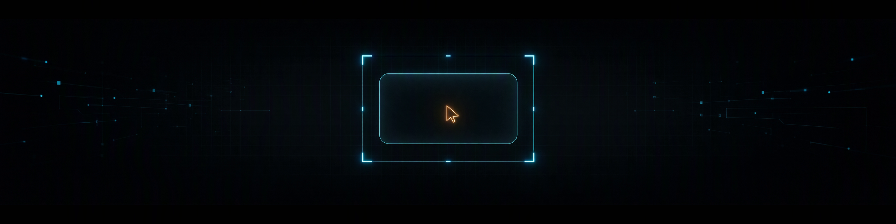
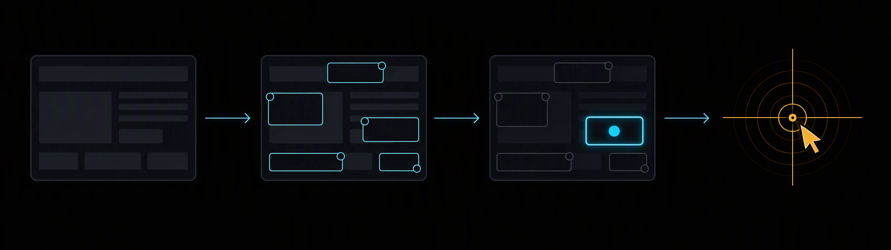
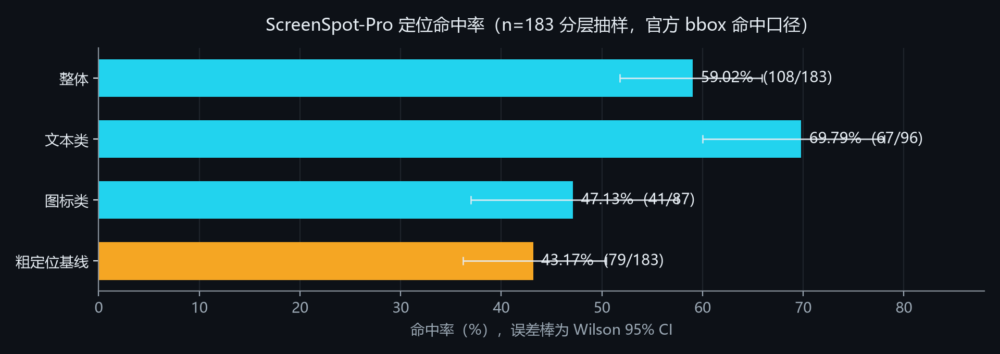
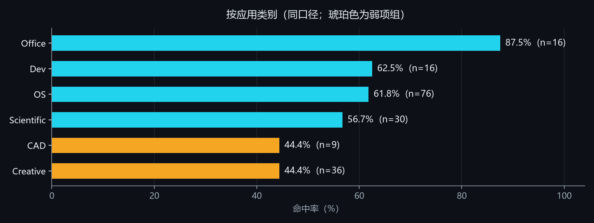
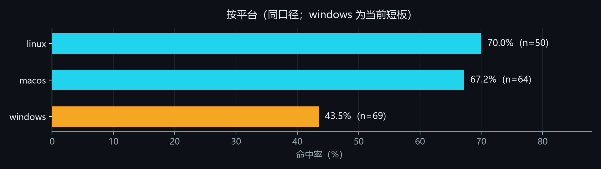
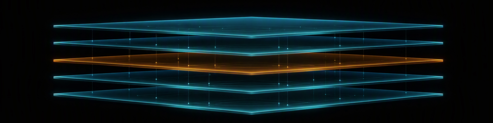
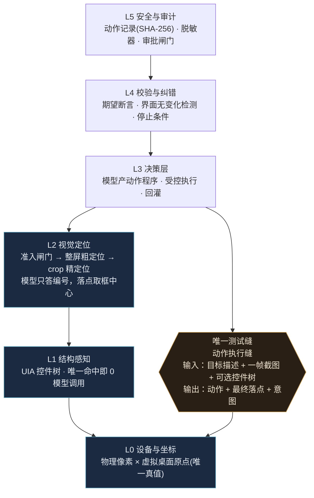

<div align="center">

# minicode

**Structure-first, vision-fallback Windows desktop computer-use agent.**

[](https://www.python.org/)
[](LICENSE)
[](CHANGELOG.md)
[](https://www.microsoft.com/windows/)
[](#测试)



给一句目标描述，它自己找元素、点击、校验回读——跑在 Windows 桌面上的 computer-use agent，纯 Python。

**结构优先**：能用 UIA 控件树 / 浏览器 DOM 描述清楚的目标不猜像素；视觉通道只做兜底，且模型只答编号、不产出坐标。

**模型无关**：任意 OpenAI 兼容端点或 Anthropic Messages 都能接，换模型不换接线；core 路径零第三方依赖。

**实测摘要**（ScreenSpot-Pro 官方 bbox 命中口径，n=183 分层抽样）：

| 口径 | 命中率 | Wilson 95% CI |
|---|---|---|
| 整体 | **59.02%**（108/183） | [51.78%, 65.89%] |
| 文本类 | 69.79%（67/96） | [59.99%, 78.07%] |
| 图标类 | 47.13%（41/87） | [36.98%, 57.51%] |
| 粗定位基线 | 43.17%（79/183） | [36.21%, 50.41%] |

真机端到端（主口径）：wave1 3/5（60%）、wave2 3/9（33.3%）。短板如实列出，见[诚实短板](#诚实短板)。

</div>

---

## 目录

- [它是什么](#它是什么)
- [实测：分维度命中率](#实测分维度命中率)
- [诚实短板](#诚实短板)
- [架构](#架构)
- [与同类项目的定位差异](#与同类项目的定位差异)
- [安装](#安装)
- [配置](#配置)
- [用法](#用法)
- [目录结构](#目录结构)
- [测试](#测试)
- [隐私与安全](#隐私与安全)
- [License](#license)
- [附注](#附注)
- [English Summary](#english-summary)

## 它是什么

minicode 是一个 Windows 桌面 computer-use agent：给一个目标描述，它自己找元素、点击、校验回读。纯 Python（3.11+），core 路径零第三方依赖（坐标换算、ctypes 执行层、协议骨架都能裸跑），图像与截图能力拆进可选 extras（`vision`：pillow + numpy；`exec`：mss + numpy）。

一次视觉定位的工作流（无字概念图，对应下文「模型选编号，不给坐标」的设计）：



从左到右：看到屏幕 → 圈定候选 → 选中 → 落点回读。落到工程上：

- **结构优先**：能用控件树（UIA）、浏览器 DOM、Windows OCR 词框描述清楚的目标，就不靠像素猜；
- **视觉兜底**：结构描述不了的目标（图标、画布、跨应用），走「截图 → 候选表 → 模型选编号 → 落点」；
- **落点可解释**：模型只回答**候选编号**，不产出坐标；落点 = 候选框的物理像素中心，坐标换算只发生在一处；
- **自己校验**：动作执行前重读、执行后回读，失败如实上报，不把「成功但坐标为空」当成成功；
- **单一测试缝**：整个系统只有一个可替换的执行缝，同一套接线既能跑真机，也能在假桌面上跑 CI。

## 实测：分维度命中率

三张图都由仓库里的 `scripts/make_figures.py` 生成，数据写死在脚本里并逐条标注来源字段（`runs/v2-eval-2016-control/sspro-report.json`），重跑可得同一张图。







数值对照（与上图逐格一致）：

| 类别 | 命中率 | n | 平台 | 命中率 | n |
|---|---|---|---|---|---|
| Office | 87.5% | 16 | linux | 70.0% | 50 |
| Dev | 62.5% | 16 | macos | 67.2% | 64 |
| OS | 61.8% | 76 | windows | 43.5% | 69 |
| Scientific | 56.7% | 30 | | | |
| CAD | 44.4% | 9 | | | |
| Creative | 44.4% | 36 | | | |

真机端到端（主口径）：wave1 3/5 = 60%；wave2 3/9 = 33.3%。

其他实测：

| 项 | 实测 |
|---|---|
| UIA 控件树唯一命中 | 落点 0.0 px、模型调用 0 次 |
| 假命中（开窗场景） | 20/175 次 |
| 回落率 | 6.86% |

> **跨跑批噪声**：同配置两次独立跑批差 ±5.46 pp（±10 条，mid-p p=0.0989，CI 跨 0）。
> 所以对外只报配对比较，不报「单次跑批绝对分的历史提升」。

## 诚实短板

- **windows 平台 43.5% 明显低于 linux 70.0% 和 macos 67.2%**（n=69 / 50 / 64）；
- **图标类 47.13% 明显低于文本类 69.79%**：图标没有可见文本，OCR 词框原理上召回不了，只能靠视觉通道，是当前最大短板；
- **CAD 44.4%、Creative 44.4% 是弱项组**（n=9 / 36）；
- **需要登录态的网站要人工先登录一次**（如微信扫码），agent 不做登录；
- **L3 的规划质量没有自动化覆盖**（只有 harness 单测）；
- **API 在 v0.1.x 仍可能变**。

## 架构





六层，自下而上：

| 层 | 包 | 职责 |
|---|---|---|
| L5 安全与审计 | `audit` · `privacy` · `redact` · `approval` | 动作记录只落 SHA-256、脱敏器、审批闸门、敏感窗口不拍 |
| L4 校验与纠错 | `verification` · `reflection` | 执行前重读、执行后回读、失败重试或停手 |
| L3 决策 | `decision` | 产出一段动作程序，在受控环境里执行 |
| L2 视觉定位 | `ground` · `model` · `calib` | 候选表到模型选编号到物理像素落点，带准入闸门 |
| L1 结构感知 | `uia` · `browser` | 控件树与 DOM 快照，能结构化就不猜像素 |
| L0 设备与坐标 | `coord` · `exec` | 虚拟桌面坐标、DPI、截图、SendInput（冻结原型） |

### 三条关键设计

1. **唯一测试缝就是动作执行缝**：输入「目标描述 + 一帧截图 + 可选控件树」，输出「动作 + 最终落点 + 意图」。真机与假桌面共用同一套接线（[ADR 0007](docs/adr/0007-single-test-seam-action-execution.md)）。
2. **坐标契约**：工程端全程物理像素，唯一真值等于物理像素乘以虚拟桌面原点；模型端量纲不写死，由运行时标定在候选标度里判定；视觉落点等于 crop 内坐标加 crop 物理原点（[ADR 0006](docs/adr/0006-crop-local-coordinate-contract.md)）。
3. **模型选编号，不给坐标**：候选源先生成带编号候选表，模型只答编号，落点取候选框物理中心，零换算。真机转换误差中位 0.0 px。

完整取舍见 [ARCHITECTURE.md](ARCHITECTURE.md) 与 [docs/adr/](docs/adr/)（8 条架构决策记录）。

## 与同类项目的定位差异

只写客观定位，不写别人的分数：

| 项目 | 它主打什么 | minicode 的差异 |
|---|---|---|
| UFO²（微软） | UIA + 像素检测混合的 GUI agent，偏 Office 场景自动化 | 不绑定某一家端点；单一可替换执行缝，真机与假桌面共用同一套接线 |
| Windows-MCP | 轻量 MCP server，把 Windows 操作暴露给 LLM | 不止暴露操作：候选表、落点校验、评测台都在仓库里，可判定验收线 |
| UI-TARS（字节） | 端到端训练的 GUI grounding 模型 | 不训练自己的模型；结构优先，UIA 能唯一命中时不进模型 |

minicode 的取舍是：不训练自己的模型、不绑定某一家端点，把工程力气花在「结构优先 + 视觉兜底」的接线、可判定的验收线、以及能复现的评测台上。

## 安装

```powershell
git clone https://github.com/xiaochuan7/minicode.git
cd minicode
pip install -e ".[vision,exec]"
```

**为什么 core 是零依赖**：坐标换算（标准库 `math`）、执行层（`ctypes` 直调 Win32 API）、模型 HTTP（标准库 `urllib`）都不需要第三方包，所以 `dependencies = []`。只有两处真正的外部能力拆进 extras：截图与图像处理（`exec`：mss + numpy；`vision`：pillow + numpy）。

开发（跑测试 / ruff）：

```powershell
pip install -e ".[vision,exec,dev]"
```

## 配置

模型无关：支持两类端点——任意 **OpenAI 兼容端点**（`POST /chat/completions`，`Authorization: Bearer`）与 **Anthropic Messages**（`POST /v1/messages`，`x-api-key` + `anthropic-version`）。配置键 `MINICODE_PROVIDER` / `MINICODE_BASE_URL` / `MINICODE_API_KEY` / `MINICODE_MODEL`，旧键 `MINICODE_ANTHROPIC_*` 仍然兼容。

把 `.env.example` 复制成仓库根目录的 `.env`，填四行：`provider / base_url / api_key / model`。`.env` 已被 `.gitignore` 排除，**不要提交**。四个可直接抄的例子：

### OpenAI

```dotenv
MINICODE_PROVIDER=openai
MINICODE_BASE_URL=https://api.openai.com/v1
MINICODE_API_KEY=<your-key>
MINICODE_MODEL=gpt-4o
```

### DeepSeek

```dotenv
MINICODE_PROVIDER=openai
MINICODE_BASE_URL=https://api.deepseek.com/v1
MINICODE_API_KEY=<your-key>
MINICODE_MODEL=deepseek-chat
```

### 阿里云百炼 DashScope（compatible-mode）

```dotenv
MINICODE_PROVIDER=openai
MINICODE_BASE_URL=https://dashscope.aliyuncs.com/compatible-mode/v1
MINICODE_API_KEY=<your-key>
MINICODE_MODEL=qwen3-vl-plus
```

### Anthropic

```dotenv
MINICODE_PROVIDER=anthropic
MINICODE_BASE_URL=https://api.anthropic.com
MINICODE_API_KEY=<your-key>
MINICODE_MODEL=claude-sonnet-4-5
```

**其它 OpenAI 兼容端点**（Moonshot / 智谱 / 硅基流动 / Ollama / vLLM / LM Studio / OpenRouter / OneAPI …）同理：`provider=openai`，把 `base_url` 指到它的 `/v1` 即可。不需要鉴权的本地端点（如 Ollama）把 `api_key` 填任意非空字符串。

两个协议的关键差别：`anthropic` 的 `base_url` **不要**带 `/v1`（程序会拼 `/v1/messages`）；`openai` 的 `base_url` **要**带版本路径 `/v1`（程序会拼 `/chat/completions`）。启动时会在 stderr 打一行实际生效的配置（`api_key` 脱敏，只留前 4 后 4），说明每个值来自哪个键。

## 用法

```powershell
minicode --help                     # 列出全部子命令
minicode action --fake --out runs   # 假桌面跑一遍最小闭环（不碰真桌面，CI 可跑）
minicode action --target "开始"      # 真机最小闭环：截图 → 定位 → 点击 → 校验
```

真机最小闭环的本机真实终端输出（2026-10-26 采集，摘录；完整输出与采集命令见 [docs/EXAMPLES.md](docs/EXAMPLES.md)）：

```text
========== M0 最小闭环 ==========
动作结果：ok=True 落点=(917, 1564)
意图    ：点击「开始」
回读偏差：0 px（验收要求 0）
落点复验：偏差=0.0 px（要求 ≤2 px）→ 通过
"channel": "uia",
"model_calls": 0,
```

动真机前请先拿桌面锁（人机互斥，锁文件不进 git）：

```powershell
python scripts/desktop_lock.py acquire --ticket demo
minicode action --target "开始"
python scripts/desktop_lock.py release
```

其它子命令：

| 命令 | 作用 |
|---|---|
| `minicode capability` | UIA 通道能力探测（读控件树、回报候选） |
| `minicode calib` | 视觉通道标定：探针图 → 判定标度 → 准入判定 |
| `minicode ground` | 视觉定位：截图 → 候选表 → 模型选编号 → 落点 |
| `minicode action` | 最小闭环：截图 → 定位 → 点击 → 校验 |
| `minicode eval` | 评测跑批与统计（ScreenSpot-Pro 等） |
| `minicode e2e` | 端到端任务跑批（真机） |
| `minicode serve` | 本地 HTTP 服务 / 动作记录查询 |
| `minicode mcp` | MCP server：把动作能力暴露给外部 agent |

每个子命令的完整参数见 `minicode <命令> --help`。

## 目录结构

```
src/minicode/
  coord/ exec/ verify/    冻结原型：坐标换算 / 截图与点击 / 落点校验（零依赖，不改逻辑）
  action/                 动作协议 v1 + 动作执行缝 + 动作记录
  uia/ browser/           L1 结构感知：控件树 / 浏览器 DOM
  ground/ calib/          L2 视觉定位：候选表 / 标定与准入
  model/                  横切：模型客户端（anthropic / openai 两种协议）+ 请求日志
  decision/               L3 决策：动作程序
  verification/ reflection/ L4 校验与纠错
  audit/ privacy/ redact/ approval/  L5 安全审计
  eval/ e2e/ serve/ mcp/  评测 / 端到端 / HTTP 服务 / MCP
docs/
  adr/                    8 条架构决策记录
  EXAMPLES.md             真实终端输出全记录（采集命令可复跑）
  spec.md                 产品规格
  privacy-policy.md       隐私政策
scripts/
  desktop_lock.py         真机占用锁（人机互斥）
  make_figures.py         README 三张数据图的生成脚本
```

## 测试

```powershell
python -m pytest -q
# 1326 passed, 257 subtests passed
python -m ruff check .
# All checks passed!
```

`src/minicode/coord`、`exec`、`verify` 是三个已验证的冻结原型：coord 与 exec 各有 README 与自测脚本，`verify/` 下是**会真调 API / 真截图 / 真点鼠标**的脚本式实测（默认不被 pytest 收集）。

## 隐私与安全

- 密钥只从仓库根目录的 `.env` 读，代码里没有第二个凭据来源；请求日志只记耗材与状态，不记密钥。
- 动作记录只落 SHA-256，不落截图本体；敏感窗口（标题命中敏感词表 / 系统对话框）在**抓帧之前**就被拦下，画面不进模型上下文。
- 控件树送模型前必须过脱敏器（两个开关同时打开才放行，fail-closed）；危险动作要过审批闸门。
- 详见[隐私政策](docs/privacy-policy.md)。

## License

[MIT](LICENSE) © 2026 xiaochuan7

## 附注

`docs/assets/social-preview.png` 是 GitHub 仓库 **Settings → Social preview** 专用的分享预览图，需要在网页设置里单独上传，不嵌进 README 正文。

## English Summary

minicode is a **Windows desktop computer-use agent** written in pure Python (3.11+, zero-dependency
core): given a natural-language target, it finds the element, clicks it, and verifies the result by
reading the screen back.

- **Model-agnostic**: works with any OpenAI-compatible endpoint (`POST /chat/completions`) or
  Anthropic Messages (`POST /v1/messages`); switching models does not change the wiring.
- **Structure-first**: UIA control trees and browser DOM snapshots are preferred — when UIA yields
  a unique hit, the agent lands with **0.0 px** error and **0 model calls**. Vision is a fallback:
  screenshot → candidate table → the model picks a number (never coordinates) → landing point.
- **Reproducible evaluation**: the evaluation harness and charting scripts live in the repo.

Measured on a ScreenSpot-Pro stratified sample (official bbox-hit protocol, n=183), grounding
accuracy is **59.02% (108/183, Wilson 95% CI [51.78%, 65.89%])**, versus **43.17% (79/183)** for
the coarse-only baseline. Known weaknesses, stated plainly: icon targets (**47.13%**, 41/87) trail
text targets (**69.79%**, 67/96); windows screens score **43.5%** (n=69) against linux 70.0%
(n=50) and macos 67.2% (n=64); CAD and Creative both sit at 44.4%; sites requiring login still
need a human to sign in once; L3 planning quality has no automated coverage yet; and the API may
still change within v0.1.x.
