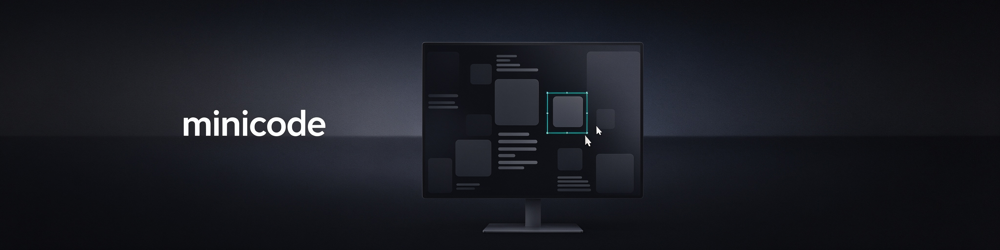
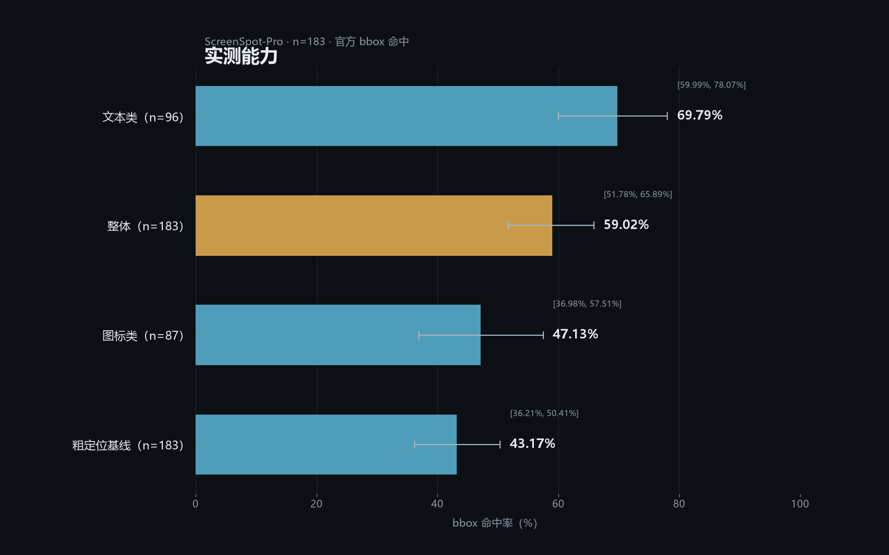
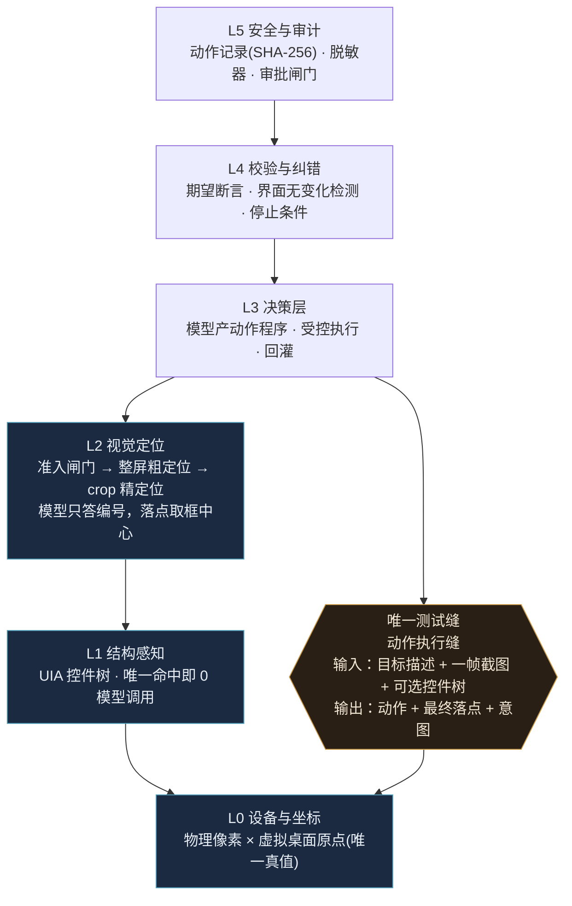

# minicode



> 让大模型像人一样操作 Windows 桌面：看屏幕、读控件树、点控件、敲键盘、自己校验。

A structure-first, vision-fallback **Windows desktop computer-use agent** with a single replaceable
execution seam.

**v0.1.1 · MIT · Python ≥ 3.11**

---

## 它是什么

minicode 是一个跑在 Windows 上的 computer-use agent 框架：

- **结构优先**：能用控件树（UIA）、浏览器 DOM、Windows OCR 词框描述清楚的目标，就不靠像素猜；
- **视觉兜底**：结构描述不了的目标（图标、画布、跨应用），走「截图 → 候选表 → 模型选编号 → 落点」；
- **落点可解释**：模型只回答**候选编号**，不产出坐标；落点 = 候选框的物理像素中心，坐标换算只发生在一处；
- **自己校验**：动作执行前重读、执行后回读，失败如实上报，不把「成功但坐标为空」当成成功；
- **单一测试缝**：整个系统只有一个可替换的执行缝，同一套接线既能跑真机，也能在假桌面上跑 CI。

## 能干什么（实测数字，不是宣传口径）

| 能力 | 实测 | 口径 |
|---|---|---|
| 屏幕控件定位（ScreenSpot-Pro 抽样） | **59.02%**（108/183），Wilson 95% CI **[51.78%, 65.89%]** | 183 条抽样；2016×1260 模型输入；always 臂（不做多次采样投票） |
| └ 文本类控件 | **69.79%**（67/96） | 同上 |
| └ 图标类控件 | **47.13%**（41/87） | 同上 —— 见「不能干什么」 |
| 真机端到端任务 wave1 | **3/5（60%）** | 主口径；浏览器三票全通过（打开职位详情 / 输入中文关键词 / 滚动 + 设置筛选） |
| 真机端到端任务 wave2 | **3/9（33.3%）** | 主口径；微信 / 设置面板 / 配置切换三组任务 |
| UIA 通道（控件树唯一命中） | 落点误差 **0.0 px**、模型调用 **0 次** | 真机 22 个控件；候选唯一时纯结构定位，不进模型 |
| 视觉通道准入标定 | 14 次标定会话全部准入可用，96 px 方块命中率 0.976~1.00 | 2560×1600 探针；早期 6 次 K=5、之后 8 次 K=21；标度判不准就拒绝运行 |

> 评测口径：同一配置跨跑批实测相差 10 条（约 5.5 pp；配对检验 p=0.0989、CI 跨 0），因此本仓只报**单批实测值**，
> 不拼接最好成绩。上面的 59.02% 是同配置重跑得到的保守值（上一轮同配置曾报 64.48%，未通过可复现性检验）。



> 数据与画图脚本都在仓库里（scripts/make_benchmark_chart.py），可复现。

## 架构



六层，自下而上：

| 层 | 包 | 职责 |
|---|---|---|
| L5 安全与审计 | `audit` · `privacy` · `redact` · `approval` | 敏感窗口不拍、凭据不出网、危险动作要审批 |
| L4 校验与纠错 | `verification` · `reflection` | 执行前重读、执行后回读、失败重试/停手 |
| L3 决策 | `decision` | 产出「一段动作程序」，在受控环境里执行 |
| L2 视觉定位 | `ground` · `model` · `calib` | 候选表 → 模型选编号 → 物理像素落点 |
| L1 结构感知 | `uia` · `browser` | 控件树 / DOM 快照：能结构化就不猜像素 |
| L0 设备与坐标 | `coord` · `exec` | 虚拟桌面坐标、DPI、截图、点击（冻结原型） |

三条关键设计（详见 [ARCHITECTURE.md](ARCHITECTURE.md)）：

- **唯一的测试缝**：整个系统只有一个可替换的「动作执行缝」，所以真机与假桌面共用同一套接线
  （[ADR 0007](docs/adr/0007-single-test-seam-action-execution.md)）。
- **坐标契约**：工程端全程物理像素（唯一真值空间）；模型端量纲**不写死**，由运行时标定在候选标度里
  判定（本机真实会话判出的是「模型看的那张图的绝对像素」）；视觉通道的最终落点是
  **crop 内坐标 + crop 物理原点**，UIA 通道落点 = 控件框物理像素中心
  （[ADR 0006](docs/adr/0006-crop-local-coordinate-contract.md)）。
- **模型选编号，不给坐标**：候选源先生成带编号的候选表，模型只答编号，落点取候选框物理中心，
  零换算（真机转换误差中位 0.0 px）。

## 不能干什么（同样重要）

- **图标类控件只有 47.13%**：图标没有可见文本，OCR 词框原理上召回不了，只能靠视觉通道，是当前最大短板。
- **Windows 设置类任务没有跑通**：wave1 的「读显示缩放值」、wave2 的「在设置面板里改一项设置」都失败。
- **需要登录态的站点要人工先登录**：微信等需要手机扫码的场景，agent 不做登录（这类任务在评测里记为 infeasible，不计入通过）。
- **只支持 Windows 10/11**（UIA / Win32 / Windows OCR）；v0.1.1 的 API 仍可能变。

## 安装

```powershell
git clone https://github.com/xiaochuan7/minicode.git
cd minicode
pip install -e ".[vision,exec]"
```

**为什么 core 是零依赖**：坐标换算（标准库 `math`）、执行层（`ctypes` 直调 Win32 API）、模型 HTTP
（标准库 `urllib`）都不需要第三方包，所以 `dependencies = []`。只有两处真正的外部能力拆进 extras：
截图与图像处理（`exec`：mss + numpy；`vision`：Pillow）。

开发（跑测试 / ruff）：

```powershell
pip install -e ".[vision,exec,dev]"
```

## 配置

把 `.env.example` 复制成仓库根目录的 `.env`，填四行：`provider / base_url / api_key / model`。
`.env` 已被 `.gitignore` 排除，**不要提交**。

### OpenAI

```dotenv
MINICODE_PROVIDER=openai
MINICODE_BASE_URL=https://api.openai.com/v1
MINICODE_API_KEY=<your-key>
MINICODE_MODEL=gpt-4o
```

### DeepSeek

```dotenv
MINICODE_PROVIDER=openai
MINICODE_BASE_URL=https://api.deepseek.com/v1
MINICODE_API_KEY=<your-key>
MINICODE_MODEL=deepseek-chat
```

### 阿里云百炼 DashScope（compatible-mode）

```dotenv
MINICODE_PROVIDER=openai
MINICODE_BASE_URL=https://dashscope.aliyuncs.com/compatible-mode/v1
MINICODE_API_KEY=<your-key>
MINICODE_MODEL=qwen3-vl-plus
```

### Anthropic

```dotenv
MINICODE_PROVIDER=anthropic
MINICODE_BASE_URL=https://api.anthropic.com
MINICODE_API_KEY=<your-key>
MINICODE_MODEL=claude-sonnet-4-5
```

**其它 OpenAI 兼容端点**（Moonshot / 智谱 / 硅基流动 / Ollama / vLLM / LM Studio / OpenRouter / OneAPI …）
同理：`provider=openai`，把 `base_url` 指到它的 `/v1` 即可。不需要鉴权的本地端点（如 Ollama）把
`api_key` 填任意非空字符串。

两个协议的关键差别：`anthropic` 的 `base_url` **不要**带 `/v1`（程序会拼 `/v1/messages`）；
`openai` 的 `base_url` **要**带版本路径 `/v1`（程序会拼 `/chat/completions`）。

> **向后兼容**：旧键 `MINICODE_ANTHROPIC_BASE_URL` / `MINICODE_ANTHROPIC_API_KEY` 仍然可用；
> 新键优先于旧键。启动时会在 stderr 打一行实际生效的配置（`api_key` 脱敏，只留前 4 后 4），
> 说明每个值来自哪个键。

## 用法

```powershell
minicode --help                     # 列出全部子命令
minicode action --fake --out runs   # 假桌面跑一遍最小闭环（不碰真桌面，CI 可跑）
minicode action --target "开始"      # 真机最小闭环：截图 → 定位 → 点击 → 校验
```

`minicode --help` 的本机真实终端输出（不是渲染、不是示意图）：

```powershell
minicode —— Windows 桌面 computer-use agent

用法：minicode <命令> [参数]

命令：
  capability  UIA 通道能力探测：读控件树并回报候选
  calib       视觉通道标定：探针图 → 判定标度 → 准入判定
  ground      视觉定位：截图 → 候选表 → 模型选编号 → 落点
  action      最小闭环：截图 → 定位 → 点击 → 校验
  eval        评测：数据集跑批与统计（ScreenSpot-Pro 等）
  e2e         端到端任务跑批（真机；动真机前先拿桌面锁）
  serve       本地 HTTP 服务 / 动作记录查询
  mcp         MCP server：把动作能力暴露给外部 agent

各命令的完整参数：minicode <命令> --help
两条最常见的用法：
  minicode --help
  minicode action --target "开始"
```

`minicode action --fake --out runs` 的本机真实终端输出（假桌面，不碰真鼠标）：

```text
========== M0 最小闭环 ==========
启动自检：awareness=PER_MONITOR_AWARE_V2 | physical=(2560, 1600) | device_caps_dpi=144 | capture=(2560, 1600)
注入自检：sizeof(INPUT)=40 (期望 40) | probe_return=1
动作结果：ok=True 落点=(1049, 1564)
意图    ：点击「开始」
回读偏差：0 px（验收要求 0）
落点复验：偏差=0.5 px（要求 ≤2 px）→ 通过
动作记录：runs\action-records.jsonl
{
  "protocol_version": "cua.action/1",
  "timestamp": "2026-10-26T12:18:03+08:00",
  "action": "click",
  "intent": "点击「开始」",
  "target": {
    "name": "开始",
    "rect": [
      1016,
      1528,
      1083,
      1600
    ],
    "control_type": "Button",
    "window_handle": 65784,
    "window_title": "任务栏"
  },
  "point": {
    "x": 1049,
    "y": 1564,
    "space": "physical-surface"
  },
  "capture": {
    "width": 2560,
    "height": 1600
  },
  "sent_size": {
    "width": 2560,
    "height": 1600
  },
  "image_source": "virtual-desktop|fake",
  "screenshot_sha256": "7d145e42fb8059ca095ed6eb032ebfefe0aede3cc86ce2c017a3defed2adaad6",
  "result": {
    "ok": true,
    "error_code": null,
    "error_message": null,
    "cursor_readback": [
      1049,
      1564
    ],
    "cursor_delta_px": 0
  },
  "rejected_candidates": [],
  "timings_ms": {
    "locate": 0.03460000152699649,
    "decision": 0.0,
    "execute_verify": 100.71860000607558
  },
  "timings_share": {
    "locate": 0.00034341342532431395,
    "decision": 0.0,
    "execute_verify": 0.9996565865746757
  },
  "action_timing": {
    "pre_move_ms": 60.22769998526201,
    "hold_ms": 40.368600020883605,
    "total_ms": 100.62499999185093,
    "double_click_gap_ms": null,
    "double_click_requested_gap_ms": null,
    "scroll_settle_ms": 0.0,
    "scroll_delta": 0,
    "wait_ms": 0
  },
  "verification": {
    "landing_delta_px": 0.5,
    "landing_verified": true
  },
  "query_scope": "",
  "params": {
    "x": 1049,
    "y": 1564,
    "space": "physical-surface"
  },
  "failures": {
    "locate": null,
    "decision": null,
    "execute": null
  },
  "redaction": null,
  "selection_echo": null,
  "allows_visual_fallback": false,
  "channel": "uia",
  "failure_type": "",
  "model_calls": 0,
  "unavailable_capture_sources": {},
  "candidate_limit": 0,
  "candidate_limit_source": "",
  "visual_admission": null,
  "coarse_point": null,
  "crop_plan": null,
  "grounding_echoes": [],
  "fallback": false,
  "fallback_reason": "",
  "fallback_cause": "",
  "gate_hit": false,
  "gate_reasons": [],
  "gate_undecidable": [],
  "refine_enabled": false,
  "state": {
    "before": null,
    "after": null
  },
  "verification_result": null,
  "approval": null,
  "privacy": null,
  "notes": []
}
==================================
```

`minicode action --target "开始"` 的本机真实终端输出（真机；含落点坐标、回读偏差、落点复验、channel、model_calls）：

```text
========== 本机 DPI 状态报告 ==========
  DPI 感知模式      : PER_MONITOR_AWARE_V2  [OK]
  物理分辨率        : 2560 x 1600 px
  逻辑分辨率        : 1707 x 1067 px
  缩放比            : 1.5x   (有效 DPI 144)
  GetDeviceCaps     : HORZRES=2560 VERTRES=1600 LOGPIXELSX=144  [与 GetSystemMetrics 一致]
  虚拟桌面          : 原点=(0, 0)  尺寸=2560 x 1600 px
  显示器数量        : 1
  坐标约定          : 物理像素，原点=虚拟桌面左上角
=========================================
========== M0 最小闭环 ==========
启动自检：awareness=PER_MONITOR_AWARE_V2 | physical=(2560, 1600) | device_caps_dpi=144 | capture=(2560, 1600)
注入自检：sizeof(INPUT)=40 (期望 40) | probe_return=1
动作结果：ok=True 落点=(950, 1564)
意图    ：点击「开始」
回读偏差：0 px（验收要求 0）
落点复验：偏差=0.0 px（要求 ≤2 px）→ 通过
动作记录：runs\action-records.jsonl
{
  "protocol_version": "cua.action/1",
  "timestamp": "2026-10-26T12:18:28+08:00",
  "action": "click",
  "intent": "点击「开始」",
  "target": {
    "name": "开始",
    "rect": [
      916,
      1528,
      984,
      1600
    ],
    "control_type": "Button",
    "window_handle": 65952,
    "window_title": null
  },
  "point": {
    "x": 950,
    "y": 1564,
    "space": "physical-surface"
  },
  "capture": {
    "width": 2560,
    "height": 1600
  },
  "sent_size": {
    "width": 2560,
    "height": 1600
  },
  "image_source": "virtual-desktop|mss",
  "screenshot_sha256": "cd24b2498754641e487b1f87548d1e2cb6a45dba6bea6f3af271f7d94390f3d2",
  "result": {
    "ok": true,
    "error_code": null,
    "error_message": null,
    "cursor_readback": [
      950,
      1564
    ],
    "cursor_delta_px": 0
  },
  "rejected_candidates": [],
  "timings_ms": {
    "locate": 159.90249998867512,
    "decision": 0.0,
    "execute_verify": 105.23369998554699
  },
  "timings_share": {
    "locate": 0.6030956919659468,
    "decision": 0.0,
    "execute_verify": 0.39690430803405324
  },
  "action_timing": {
    "pre_move_ms": 60.425000003306195,
    "hold_ms": 43.994200008455664,
    "total_ms": 105.02839999389835,
    "double_click_gap_ms": null,
    "double_click_requested_gap_ms": null,
    "scroll_settle_ms": 0.0,
    "scroll_delta": 0,
    "wait_ms": 0
  },
  "verification": {
    "landing_delta_px": 0.0,
    "landing_verified": true
  },
  "query_scope": "",
  "params": {
    "x": 950,
    "y": 1564,
    "space": "physical-surface"
  },
  "failures": {
    "locate": null,
    "decision": null,
    "execute": null
  },
  "redaction": null,
  "selection_echo": null,
  "allows_visual_fallback": false,
  "channel": "uia",
  "failure_type": "",
  "model_calls": 0,
  "unavailable_capture_sources": {},
  "candidate_limit": 0,
  "candidate_limit_source": "",
  "visual_admission": null,
  "coarse_point": null,
  "crop_plan": null,
  "grounding_echoes": [],
  "fallback": false,
  "fallback_reason": "",
  "fallback_cause": "",
  "gate_hit": false,
  "gate_reasons": [],
  "gate_undecidable": [],
  "refine_enabled": false,
  "state": {
    "before": null,
    "after": null
  },
  "verification_result": null,
  "approval": null,
  "privacy": null,
  "notes": []
}
==================================
```

上面命令清单里的最后一条等价于 `python -m minicode.action --target "开始"`（`pip install -e .` 之后两种写法都可以）。
动真机前请先拿桌面锁（人机互斥，锁文件不进 git）：

```powershell
python scripts/desktop_lock.py acquire --ticket demo
python -m minicode.action --target "开始"
python scripts/desktop_lock.py release
```

其它子命令：

| 命令 | 作用 |
|---|---|
| `minicode capability` | UIA 通道能力探测（读控件树、回报候选） |
| `minicode calib` | 视觉通道标定：探针图 → 判定标度 → 准入判定 |
| `minicode ground` | 视觉定位：截图 → 候选表 → 模型选编号 → 落点 |
| `minicode action` | 最小闭环：截图 → 定位 → 点击 → 校验 |
| `minicode eval` | 评测跑批与统计（ScreenSpot-Pro 等） |
| `minicode e2e` | 端到端任务跑批（真机） |
| `minicode serve` | 本地 HTTP 服务 / 动作记录查询 |
| `minicode mcp` | MCP server：把动作能力暴露给外部 agent |

每个子命令的完整参数见 `minicode <命令> --help`。

## 目录结构

```
src/minicode/
  coord/ exec/ verify/    冻结原型：坐标换算 / 截图与点击 / 落点校验（零依赖，不改逻辑）
  action/                 动作协议 v1 + 动作执行缝 + 动作记录
  uia/ browser/           L1 结构感知：控件树 / 浏览器 DOM
  ground/ calib/          L2 视觉定位：候选表 / 标定与准入
  model/                  横切：模型客户端（anthropic / openai 两种协议）+ 请求日志
  decision/               L3 决策：动作程序
  verification/ reflection/ L4 校验与纠错
  audit/ privacy/ redact/ approval/  L5 安全审计
  eval/ e2e/ serve/ mcp/  评测 / 端到端 / HTTP 服务 / MCP
docs/
  adr/                    8 条架构决策记录
  spec.md                 产品规格
  privacy-policy.md       隐私政策
scripts/desktop_lock.py   真机占用锁（人机互斥）
```

## 测试

```powershell
python -m pytest -q
# 1326 passed, 257 subtests passed
python -m ruff check .
# All checks passed!
```

`src/minicode/coord`、`exec`、`verify` 是三个已验证的冻结原型：coord 与 exec 各有 README 与自测脚本，
`verify/` 下是**会真调 API / 真截图 / 真点鼠标**的脚本式实测（默认不被 pytest 收集）。

## 隐私与安全

- 密钥只从仓库根目录的 `.env` 读，代码里没有第二个凭据来源；请求日志只记耗材与状态，不记密钥。
- 敏感窗口（标题命中敏感词表 / 系统对话框）在**抓帧之前**就被拦下，画面不进模型上下文。
- 控件树送模型前必须过脱敏器（两个开关同时打开才放行，fail-closed）。
- 详见 [隐私政策](docs/privacy-policy.md)。

## License

[MIT](LICENSE) © 2026 xiaochuan7

## 维护者备注

`docs/assets/social-preview.png` 是 GitHub 仓库 **Settings → Social preview** 专用的分享预览图，
需要在网页设置里单独上传，不嵌进 README 正文。
